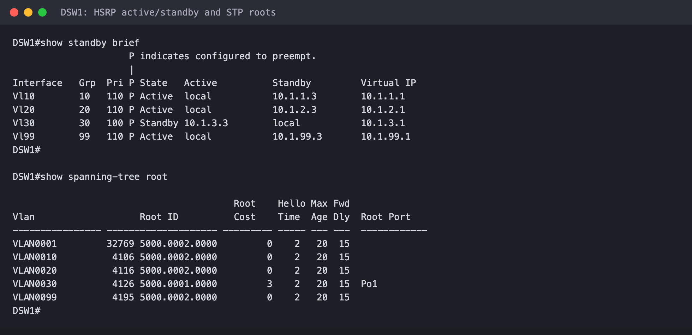
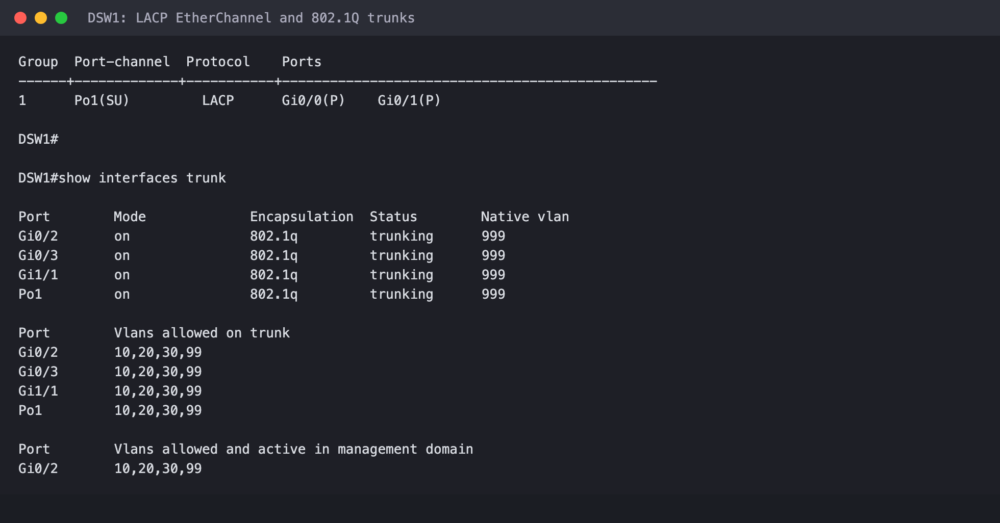
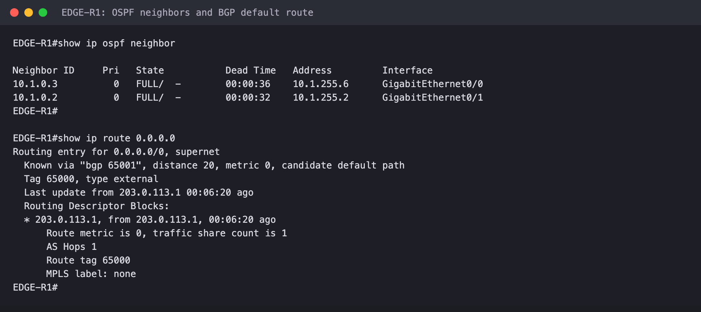
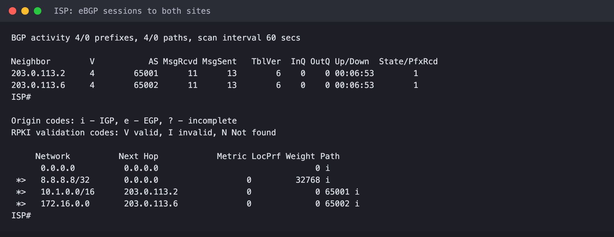
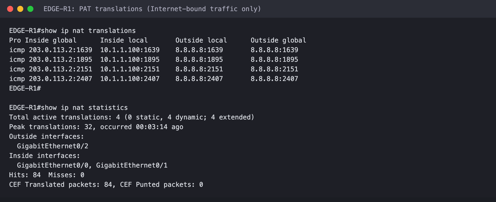
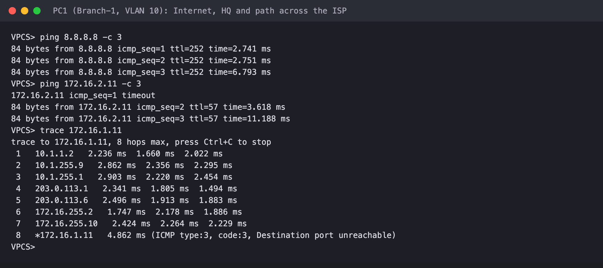

# Enterprise Network Lab (Branch + HQ) in EVE-NG

So i wanted to build a proper enterprise network and not just a couple routers pinging each other. Most labs i had done before were small, like a router and a switch and a few PCs, and i wanted to see what it actually looks like when you build something that resembles a real company network. I found a campus design diagram with two sites, a bunch of core routers, distribution switches and access switches, and i thought ok lets try to build my own version of that in EVE-NG and get it working end to end.

The end result is two sites, Branch-1 and HQ, with a fake ISP sitting in the middle connecting them. Each site has an edge router, two core routers, two layer 3 distribution switches, and three access switches with PCs (Branch-1) or servers (HQ) plugged in. Its 17 network devices in total plus 12 endpoints. All the final configs are in the configs folder if you wanna look.

## What i used

IOSv for the routers and the ISP, vIOS-L2 for the distribution switches (these can route when you turn on ip routing, so they act like layer 3 switches), and IOL L2 for the access switches because its way lighter on RAM. This is all on EVE-NG Community running on a VM with 16GB of RAM and 8 cores.

One thing to know, dont start all the nodes at once. When i started all 29 of them together my EVE-NG server almost froze, because IOSv and vIOS-L2 both eat a lot of CPU while they boot. Start them in batches, routers first and then the switches and then the PCs, and the IOL switches dont need much RAM so you can turn that down.

## The addressing

I started with the addressing before touching any device because i wanted it to look like a real network and not just random numbers. Every link between routers, or between a router and a switch, is a /30. Every VLAN is a /24. Loopbacks are /32. Branch-1 uses 10.1.x.x and HQ uses 172.16.x.x so its easy to tell which site you are looking at.

There are three floor VLANs (10, 20, 30) and a management VLAN 99. Each floor has its own subnet, so VLAN 10 at Branch-1 is 10.1.1.0/24 and VLAN 10 at HQ is 172.16.1.0/24. The full list of every address is in docs/ip-plan.csv and every cable is in docs/cabling.csv.

Before i configured anything i also checked the cabling with CDP on every device and compared it to my plan. It sounds boring but it saved me from chasing problems later that were really just a cable in the wrong port.

## Access layer

The access switches are just layer 2. Each one has two trunks, one to each distribution switch, so if a distribution switch dies the access switch still has a way out. The ports where the PCs and servers plug in are set to the right floor VLAN, with portfast, BPDU guard and port security turned on. All the unused ports are shut down, and each switch has a management address on VLAN 99.

I also set the native VLAN on the trunks to 999, which is a VLAN nobody uses. Its a small thing but its a common hardening step.

## Distribution layer

This is where most of the interesting stuff is. The two distribution switches at each site are the gateways for the VLANs, and i used HSRP so the PCs always have a gateway even if one switch goes down. Both switches share a virtual address ending in .1 on every VLAN, and one of them is the active one.

I split the work between the two switches so one isnt doing everything. At Branch-1 DSW1 is the main gateway for VLAN 10, 20 and 99 and DSW2 is the main one for VLAN 30. At HQ its the other way around. Then i set the spanning tree root to match whichever switch is the HSRP gateway for that VLAN, so traffic doesnt take a weird detour between the root and the gateway.

Here is what one of the VLAN interfaces looks like on DSW2:

```
interface Vlan10
 description FLOOR1
 ip address 10.1.1.3 255.255.255.0
 ip access-group V10-IN in
 ip helper-address 10.1.0.1
 standby version 2
 standby 10 ip 10.1.1.1
 standby 10 timers 1 3
 standby 10 preempt
 ip ospf 1 area 0
```

The two switches are also connected to each other with two links bundled into one LACP EtherChannel. I put ACLs on the VLAN 10 and VLAN 30 interfaces so those two floors cant talk to each other, just so i had some real policy in the lab and not only routing. The uplinks to the core are routed /30 links, not switchports.

## Core layer

The core routers are pretty simple, which is kind of the point. Each site has two of them, and each one connects to the edge router and to both distribution switches, so there are two paths in every direction. They only run OSPF. I used area 0 inside each site, point to point links, and passive-interface default so OSPF only runs on the links where i actually want it.

## Edge and ISP

The edge routers are where the site connects to the outside. Each one runs BGP to the ISP. Branch-1 is AS 65001, HQ is AS 65002 and the ISP is AS 65000. Each edge advertises its whole site block (10.1.0.0/16 or 172.16.0.0/16) and the ISP sends back a default route. The edge then passes that default route into OSPF, so every device inside the site knows how to get out.

On EDGE-R1 it looks like this:

```
router bgp 65001
 bgp router-id 10.1.0.1
 network 10.1.0.0 mask 255.255.0.0
 neighbor 203.0.113.1 remote-as 65000
!
ip route 10.1.0.0 255.255.0.0 Null0
```

That Null0 route looks strange but its there so the router has the whole 10.1.0.0/16 block in its routing table, otherwise BGP wont advertise it.

The ISP is just another router. It has a loopback at 8.8.8.8 that pretends to be the internet, and it passes each site's block over to the other site, which is how Branch-1 and HQ reach each other.

The edge routers also do NAT (PAT) so the internal addresses can reach 8.8.8.8. I made sure traffic going between the two sites doesnt get NATed, only the internet traffic does. This is done with an ACL that denies the other site's range first:

```
ip access-list extended NAT-INSIDE
 deny   ip 10.1.0.0 0.0.255.255 172.16.0.0 0.0.255.255
 permit ip 10.1.0.0 0.0.255.255 any
!
ip nat inside source list NAT-INSIDE interface GigabitEthernet0/2 overload
```

## DHCP

One thing thats a bit weird, the Branch-1 PCs get their IPs from DHCP running on EDGE-R1, and the distribution switches relay the requests to it with the ip helper-address command. In a real network you would use a proper DHCP server for this, i just didnt have one in the lab so the edge router did it. The HQ servers just use static IPs, which makes more sense for servers anyway.

## Does it actually work

Yeah it does. Here are some screenshots from the lab.

HSRP and spanning tree on DSW1, you can see it's the active gateway for VLAN 10, 20 and 99 and standby for 30, and DSW1 is also the spanning tree root for those same VLANs:



The LACP bundle between the distribution switches and the trunks down to the access switches:



OSPF neighbors on EDGE-R1 and the default route it learned from the ISP over BGP:



The ISP with both BGP sessions up, one to each site:



NAT on EDGE-R1, you can see only the internet traffic from PC1 gets translated:



And this is PC1 in Branch-1 pinging the internet and an HQ server, then a traceroute showing it going through the whole path. It goes DSW1, a core router, the edge, the ISP, then HQ's edge, a core router, and DSW3, and finally the server:



## Failover tests

I also wanted to see it survive something breaking, because thats the whole point of building it with two of everything.

For the first test i started a long ping from PC1 to an HQ server and then shut down the VLAN 10 interface on DSW1 while it was running. DSW2 took over as the gateway and i only lost 2 pings out of 45. When i brought DSW1 back, it took the gateway back on its own because of the preempt command.

For the second test i pinged 8.8.8.8 and shut down one of the links on EDGE-R1. OSPF moved the traffic to the other core router and i lost 4 pings out of 35. After that i brought the link back up.

I also tested the ACL. A PC in VLAN 10 cant reach VLAN 30, which is what i wanted, and VLAN 20 can still reach both.

## Stuff that surprised me

The IOSv routers come up with all their interfaces shut down, so nothing works (and CDP shows nothing) until you no shut them.

Every device starts out called Router or Switch, so i set the hostnames first, otherwise the CDP output is impossible to read when you check the cabling.

And the IOL L2 image doesnt support SSH at all, so the access switches are a bit less locked down than the rest.

## Stuff i would still do or fix

I didnt do any QoS or OSPF authentication, and both would be good to add. I also left the unused ports on the distribution switches up and the HTTP server is on because thats the default on that image. In a real network i would turn both of those off. And like i said, DHCP should be on a real server and not on the edge router.

If i did it again i would probably also add a second edge router at each site, because right now the edge router is the one thing that isnt redundant.

## What is in this repo

The configs folder has the final running config of every device. The docs folder has the IP plan and the cabling list. The images folder has the screenshots above. Passwords are removed from the configs and its just a lab so there is nothing real in here.
